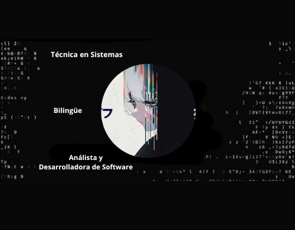

  

<!-- NEW: header wave -->

<h1 align="center">Hi 👋, I'm Valentina Blandón Vélez</h1>
<h3 align="center">A passionate full stack developer from Colombia</h3>

<!-- NEW: animated typing line + profile badges -->

  

  
  
  
  

- 🔭 I'm currently working on **my project, a dog spa; on the other hand, I also do small projects to practice Dockerization and website deployment.**

- 🌱 I'm currently studying **Software Analysis and Development, C#, Docker, and deployment. I'm also studying English and have a B1 level.**

- 👯 I'm looking to collaborate on **different projects to expand my knowledge.**

- 🤝 I'm looking for help with **Java, object-oriented programming, and to further develop my skills as a full-stack developer.**

- 📫 How to reach me **valentinablandon12345678@gmail.com**

- 👨‍💻 All of my projects are available at **[https://github.com/ValenBV1013](https://github.com/ValenBV1013)**

<!-- NEW: quick facts -->
- 🌎 Based in **Colombia** 🇨🇴

- 🗣️ Languages: **Spanish (native) · English (B1)**

- ⚡ Fun fact: **I'm building a real-world product (a dog spa) while I keep learning DevOps practices.**

 

<h3 align="left">Connect with me:</h3>

<h3 align="left">Languages and Tools:</h3>

 
   
   
   
   
   
   
   
   
   
   
   
   
   
   
   
   
   
   
   
   
   
  

<!-- ============================================================ -->
<!-- NEW SECTIONS START HERE                                      -->
<!-- ============================================================ -->

---

<h3 align="left">🧰 Tech Stack by Area:</h3>

<table>
  <tr>
    <td><b>🎨 Frontend</b></td>
    <td>
      
      
      
      
      
      
    </td>
  </tr>
  <tr>
    <td><b>⚙️ Backend</b></td>
    <td>
      
      
      
      
      
      
    </td>
  </tr>
  <tr>
    <td><b>🗄️ Databases</b></td>
    <td>
      
      
      
    </td>
  </tr>
  <tr>
    <td><b>🚀 DevOps & Tools</b></td>
    <td>
      
      
      
      
      
    </td>
  </tr>
</table>

---

<h3 align="left">📚 Currently Learning:</h3>

  
  
  
  

---

<h3 align="left">📊 GitHub Stats:</h3>

  
  

---

<h3 align="left">⭐ Featured Projects:</h3>

<!--
  TIP: To show your best repos as cards, replace REPO-NAME-1 and REPO-NAME-2
  with the exact names of your repositories, then delete this comment block
  and remove the surrounding comment markers below.

  
  

-->

- 🐶 **Dog Spa Project** — my main project, a full management/website solution for a dog spa. *(add the repo link here)*
- 🐳 **Docker & Deployment practice** — small projects where I practice containerization and deploying websites. *(add the repo link here)*

👉 More at **[github.com/ValenBV1013?tab=repositories](https://github.com/ValenBV1013?tab=repositories)**

---

<h3 align="left">📫 Let's work together!</h3>

  I'm open to <b>collaborations</b>, <b>learning opportunities</b> and <b>junior full stack roles</b>. Feel free to reach out:

  
  

  <i>"First, solve the problem. Then, write the code."</i> 💜

<!-- NEW: footer wave -->

